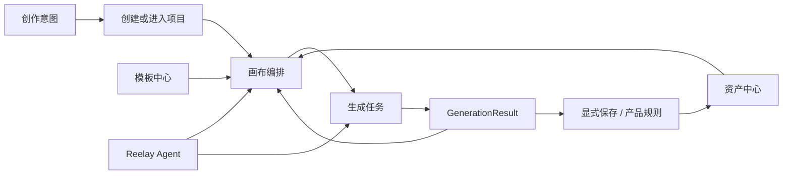
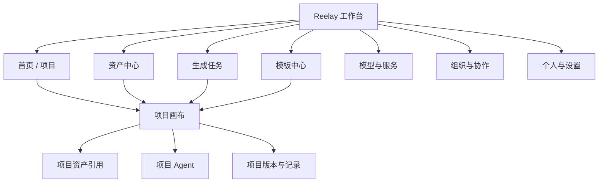
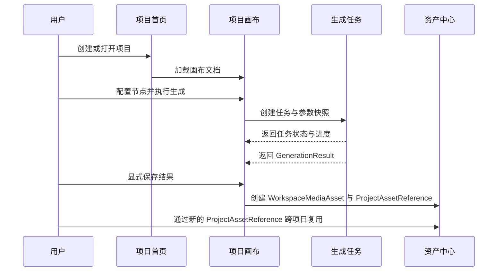

# Reelay 产品扩展规划

本文保留尚未完成的产品目标、已确认规则和待验证假设。已实现行为统一见 [当前产品规范](current-product-spec.md)，当前代码与发布状态见 [交接](agent-handoff.md)；下述页面结构是后续设计输入，不代表已实现或已排期。

## 1. 产品定位

本项目定位为 **Reelay 产品预演版**：提前构建和验证正式产品的页面结构、交互行为、业务规则、状态变化及异常恢复，供团队进行需求讨论与行为验收，并作为后续正式前端开发的产品行为蓝本。

核心原则是：**已确认的业务规则可执行，前端交互真实，后端服务可模拟。** 尚未接入的模型调用、支付、验证码和积分结算可以使用预置素材、模拟请求与可控制状态。现有共享会话、项目权限、PostgreSQL 与私有 ObjectStore 保留已验证能力，不因产品预演定位重写，也不因已有云服务而扩大生产化范围。正式授权、计费和幂等性由服务端承担，前端演示判断不能作为生产安全边界。

“完整产品体验”是逐步覆盖的目标，不代表当前所有页面或流程已经确定。每个功能应区分已确认规则、可逆设计假设和未实现能力；参考图、暂时文案和演示数据不能自动升级成产品需求。被选入当前切片的行为，应具备一致的前后状态、可解释的失败和可重复的演练方式；尚未确定的规则保留为待决事项，不由实现者静默补全。

已确认的后续方向包括主体与节点配合、项目生成历史、消息通知与必要配置、分享权限 / 申请加入闭环，以及两位成员以不同账号、不同浏览器真实同时编辑同一画布。页面内 Agent 模拟生成与画布整理已有实现，后续从现有行为继续，不重建另一套状态来源；剩余治理随产品切片推进，建议路线和阶段验收见 §8.1。

产品面向 B 端，访客主页与登录弹窗的当前行为见产品规范 §2.1。手机号 / 邮箱注册保留为后续方向；邀请码已明确用于注册资格，不能默认建立组织 Membership。邀请码的发放 / 次数 / 有效期、验证码、密码与账号关联等规则仍待确认，当前注册入口保持禁用。

蓝本应沉淀产品行为及验收场景，代码是否直接进入正式前端另行评估；画布库与组件实现属于可替换的技术选择。

Reelay 不应只是一块无限画布，也不应演变成把大量后台页面包在画布周围的重型工作台。

更合适的产品结构是：

- 工作台负责管理项目、资产、任务、模板和团队。
- 项目画布负责沉浸式创作、节点组织和 Agent 协作。
- 两种状态共享账号、积分、模型、生成任务和素材数据，但使用不同的信息密度与导航方式。

### 1.1 当前工作假设

以下是为了让基础开发可以前进而采用的可逆假设，不是不可更改的产品结论：

- 首期账号主要属于一个组织 Workspace；“个人 / 协作项目”是同一组织内的项目访问类型，不再为每个账号复制一套个人 Workspace。个人项目只对创建者可见，协作项目通过显式 ProjectMembership 分配成员与角色。
- 可跨项目复用的 WorkspaceMediaAsset 归 Workspace 所有，Project 使用 ProjectAssetReference，Node 后续也只保存显式稳定引用。尚未保存的生成结果仍是 GenerationResult，不会自动污染全局资产中心。
- 首期按 Reelay 统一提供模型服务设计，但 ProviderConnection 保留扩展边界；不在首期同时建设 BYOK 的密钥、配额和故障处理体系。
- 分享与协作继续建立在组织 Membership 和显式 ProjectMembership 之上。已有多账号项目访问基础；后续先完成授权与申请闭环，再进入真实双浏览器同时编辑。分享对象、外部成员范围和并发冲突策略仍须在相应切片确认。
- 页面与画布的技术边界沿用 [运行时 ADR](adr/0001-application-runtime-and-migration.md)。框架和画布库是可替换选择，产品扩展不以整体重写画布为前置条件。

任何一项假设改变时，都必须同时复核路由、权限、资产归属、计费和迁移策略。

核心价值链：

## 2. 产品信息架构

## 3. 导航策略

### 3.1 工作台模式

资产中心、生成任务等高信息密度管理页可以使用稳定的左侧主导航；登录后主页本身保持轻量创作入口，不为尚未实现的后台页面提前常驻完整侧栏：

- 首页 / 项目
- 资产中心
- 生成任务
- 模板中心
- 模型与服务
- 组织
- 底部：积分、通知、个人

管理页主导航保持窄而稳定，不使用大面积装饰；主页可以用项目封面与创作主题建立进入画布前的内容语境，但不做公开营销首页或作品社区。

### 3.2 画布模式

进入项目后使用沉浸式画布，不常驻完整工作台导航；现有工具位置与手势统一见产品规范。后续跨页面导航需定义视口、选中状态和未完成输入的恢复范围，不能把当前 CanvasDocument 保存视口等同于已经实现全部草稿恢复。

## 4. 页面规划

## 4.1 首页 / 项目

已有主页、项目库、访问控制、创建 / 改名和软删除行为见产品规范 §2。后续以继续最近工作、从模板新建、查找个人 / 团队项目和感知任务状态为目标：

- 项目复制、移动、归档，以及草稿、与我共享、已归档的检索范围；按需要补充列表视图。项目卡保留键盘进入，双击只作为增强入口。
- 回收站列表、恢复和永久删除。当前软删除只撤销访问并保留记录，恢复权限、保留周期与永久删除规则另行确定。
- 从实际画布生成项目封面；当前示例封面不能冒充用户画布内容。卡片按需求展示项目名、组织 / 访问类型、最近编辑、协作者与生成中 / 失败状态。
- 正在生成数量、可用积分、最近失败任务等轻量状态必须消费任务与账本来源，不能从节点单个当前结果反推。
- 工作区切换、通知和完整搜索随具体业务接入；主页保持轻量创作入口，不扩成宣传落地页。

## 4.2 资产中心

正式 React 资产中心、Folder / organization placement、Entity 删除恢复、组织权限和平台目录仍待实现。现有画布资产库、个人 Media / Entity 和私有对象存储行为见产品规范 §7.6；后续沿用这些领域边界。

### 页面目标

- 管理已经保存为 Workspace Media Asset 的图片、视频和音频；未晋升的 GenerationResult 只在任务或节点结果历史中管理。
- 管理只引用 Media、不重复保存媒体字段或二进制的 Entity 主体；直接创建主体时，新媒体必须先登记到 Media，再由 Entity 保存有序引用。
- 查看素材被哪些项目或节点引用。
- 批量整理、重命名、下载和删除。

### 页面结构

顶层空间与分栏：

- 个人空间与组织空间是 Workspace Asset 的不同可见 / 发布位置，不复制底层 Media；平台空间来自单独的只读目录，不能伪装为当前 Workspace 的可写资产。
- Media 素材与 Entity 主体库独立展示；Media 支持图片、视频、音频筛选，Entity 通过 Media 引用形成预览。

完整页面后续筛选：

- 全部。
- 图片。
- 视频。
- 音频。
- 收藏。
- 最近使用。
- 回收站。

顶部筛选：

- 来源：本地上传、由 GenerationResult 显式保存、团队共享。
- 所属项目。
- 创建者。
- 模型。
- 时间。
- 分辨率 / 时长。

主体：

- 网格视图用于视觉检索。
- 列表视图用于批量管理。
- 右侧检查器显示预览、元数据、引用关系和版本。

### 关键交互

- 拖入上传。
- 创建主体时，先完成 Media 上传与登记，再保存 Entity 的有序 Media 引用；两者是独立生命周期，主体保存失败不删除已经上传的 Media。删除 Entity 不删除 Media。
- 批量加入项目（创建 ProjectAssetReference，不复制 WorkspaceMediaAsset 所有权）。
- 打开素材所在画布并定位节点。
- 查看生成提示词和模型参数。
- 删除前检查引用关系。

### 画布大文件、剪辑与存储回收（后续）

实验分支已接入的上传格式、单文件策略和个人 / 组织容量见[资产库规范](current-product-spec.md#76-资产库)。资产库本地上传的 50 MiB 是入口规则，不是画布节点或未来剪辑成片的领域上限；当前传输实现仍有环境限制，不宣称已经支持 GB 级成片。

- 剪辑文档保存源媒体 ID / 版本、入出点、轨道、顺序、转场和音量等参数，不把视频字节嵌进 CanvasDocument；拖入多个素材只是引用。原文件与已保存导出结果计入所属个人或组织容量，播放代理、缩略图等系统缓存单独治理。
- 导出以异步渲染任务产生新版本的不可变媒体，先按任务归属预留输出容量，成功核验后转为已用并关联到发起画布。源文件不被覆写；取消、失败重试和跨画布回调必须遵守幂等与归属校验。估算不足时须重新取得容量，不能先突破配额再补记。
- 大文件需完整的分片 / 可恢复上传、流式哈希和校验、Range 播放、低码率代理及对象授权结束证明；现有浏览器和服务端整文件缓冲路径不直接提高到 GB 上限。传输成功不等于模型可直接接收，真实供应商接入时另按模型 / 渠道校验输入格式、数量、时长和分辨率；SVG 的栅格化也属于该适配阶段。
- 容量回收后续建立源文件管理和引用核验入口，覆盖项目、素材组、画布文档、撤销保留及正在运行任务。移除库条目不等于删除原文件；没有引用且越过保留期后，才可通过有确认的物理回收释放容量。
- 远端签名上传取消目前保守保留额度，直至能证明所有在途写入已经结束；不能仅凭 token 过期删除对象并释放。后续需要可撤销 / 有明确完成证明的上传通道，才能自动安全回收这些预留。历史未完成上传的远端授权情况未知，也不擅自释放。
- 退出或被移出旧 Workspace 后的个人预留需要账号归属级的清理授权；当前清理仍要求原 Workspace 的有效身份，不能把跨空间用量汇总理解成已经实现离组清理。迁移既有云端数据前先核对历史未完成对象的实际字节与授权状态。

### 主体的使用与生命周期

Entity 是素材的组织方式和选择范围，不是新的生成输入类型。使用主体时，确定本次选用的 Media 集合：加入生成节点后展开为独立素材引用或连接；添加到画布后创建独立素材节点，不创建整体主体节点，也不建立随 Entity 自动更新的绑定。

主体后续改名、修改描述 / 封面、增删或重排成员，以及删除主体，都不增删、重排或替换先前展开的输入、连接和画布节点。再次使用主体才读取其当前素材集合。移除某处输入只移除该处引用，不删除主体或全局 Media。

主体编辑与底层 Media 修改是不同操作。例如，在主体编辑器中重命名素材文件属于 Media 操作；底层素材被删除、权限被撤销或版本变化时如何处理既有使用，需在 Media 生命周期中另行明确，不能从“删除主体无联动”推导。模型容量不足、不支持类型、缺失素材，以及部分成功还是整体拒绝的处理保留为后续具体设计。

现有代码已有逐 Media 展开的适配，下一步优先核对其选择、独立操作、保存恢复与主体编辑后不联动的行为，补齐必要的 Media 引用边界；本节不代表持久 Entity 删除或完整 Node 级引用已经实现。

## 4.3 生成任务

已确认要提供项目生成历史；建议先完成项目内查询、结果复用与来源定位，再视需要扩展跨项目任务控制台，不能把跨项目大页面作为当前前置条件。

生成历史的生命周期独立于画布展示：以 GenerationTask / GenerationResult 为记录来源，不从当前节点的单个 `generatedAsset` 或页面内 runner 反推历史。重新生成、切换显示结果、移除节点与删除历史是不同动作；关闭页面后的任务行为、记录保留与删除规则仍待该切片确认。来源节点不存在时，历史仍需按选定规则展示结果或不可用原因，不能提供失效的定位成功反馈。画布版本 / 操作日志另行设计，不与生成历史混为一种记录。

### 页面目标

- 查看排队、运行、成功、失败和取消任务。
- 追踪积分消耗。
- 重试失败任务。
- 回到发起任务的节点。

### 信息结构

默认表格字段：

- 结果缩略图。
- 任务状态。
- 项目 / 节点。
- 模型。
- 类型。
- 参数摘要。
- 发起人。
- 创建时间。
- 耗时。
- 积分。

### 关键交互

- 按状态、项目、模型、创建者筛选。
- 批量取消排队任务。
- 失败任务查看错误原因并重试。
- 成功任务打开结果、加入资产库或定位画布节点。
- 任务详情展示输入、输出、参数快照和积分账目。

## 4.4 模板中心

模板不是静态截图，而是可实例化的画布结构。

### 模板类型

- 图片生成流程。
- 图生视频流程。
- 广告分镜。
- 商品图批量生成。
- 角色一致性。
- 音乐与声音设计。
- 团队自定义模板。

### 模板详情

- 实际画布预览。
- 节点数量和模型依赖。
- 所需输入素材。
- 预计生成步骤。
- 可替换模型。
- 创建项目按钮。

### 建议

首期只做官方模板和团队模板，不急于建设公开社区与点赞体系。

## 4.5 模型与服务

该页面承担模型目录、能力说明和供应商连接，不把所有设置塞进节点下拉菜单。

### 页面目标

- 查看当前可用模型。
- 理解模型能力、限制、价格和状态。
- 设置默认模型与禁用模型。
- 管理供应商连接。

### 模型信息

- 供应商。
- 输入 / 输出模态。
- 支持的比例、分辨率、时长。
- 参考素材上限。
- 是否原生音频。
- 预计速度。
- 积分计算规则。
- 服务状态。

### 设计建议

- 节点模型面板只负责快速选择。
- 模型中心负责完整比较和配置。
- 模型能力与成本继续以 `data/model-catalog.js` 为单一来源，不为新页面复制目录。

## 4.6 组织与协作

### 后续范围

现有组织中心、成员目录、演示用量与积分交互见产品规范 §2；它们不等于成员生命周期、真实账单或多人并发已经完成。组织 Membership 证明组织归属，ProjectMembership 决定项目读写，两者不能互相代替。

已确认的协作目标包含两个阶段：分享权限 / 申请加入的可执行闭环，以及最终两位成员在不同浏览器真实同时编辑同一画布。申请、批准和实际访问权限必须一致；在线状态、光标与选中态只是辅助体验，虚拟光标或预置远端动作不能替代真实并发验收。具体分享对象、组织外访问、申请处理人、冲突与撤销规则在进入相应阶段时复核，见第 8.1 节。

- 成员邀请、状态管理和成员生命周期；只读成员列表已经在组织中心首个切片中建立。
- 组织所有者 / 成员管理，以及项目 `admin/edit/view` 角色的配置界面和完整权限矩阵。
- 团队资产与积分使用概览。
- 项目成员的添加、移除和权限变更。
- 评论与 @ 提及。
- 在线状态与实时协作光标，以及真实多人内容编辑。
- 审批流程。
- 品牌资产与模型策略。

## 4.7 个人与设置

现有个人资料与积分面板见产品规范 §2。完整设置后续承载通知、默认项目 / 模型、快捷键、下载与隐私、连接服务和真实账单；外观沿用共享主题。头像菜单保留高频入口与摘要，复杂设置进入独立内容区域。

## 4.8 Agent 工作区

当前项目内 Agent 继续保留右侧栏。

生成模式的页面内任务、取消 / 退款演示和自动放入发起画布已见 [当前产品规范 10.7](current-product-spec.md#107-生成模式的一条式记录与模拟任务)，普通 Agent 工具编排尚未实现。

后续任务与集成边界：

- **持久任务与跨页面恢复。** 普通 Seedance 视频已按 §8.3 接入服务端持久任务，浏览器共用 service 投影其状态；图片及无连接视频保留页面内模拟。完整 Conversation、参考上传和其它 Provider 仍待后续，不能只替换模拟 executor 或把前端 scope 当作授权。正式输入继续沿用不可变文档、模型参数与有序参考，真实普通视频当前明确拒绝非空参考。
- **真实执行与取消。** 真实受理、取消、错误与退款规则以平台协议和服务端事实为准，不能沿用演示时限或 owner 失效即取消的规则。收费权威与账本条件见 §8.2：平台唯一扣费时关联其回执，不重复扣模拟积分；本系统经营积分时，才以持久 CreditLedger 的幂等结算和余额一致性替换 `3000 / 0` 的 mock 契约。
- **项目历史与结果身份。** 后续项目生成历史读取同一任务来源，持久 Result 与画布媒体引用建立稳定关系，不在对话、历史、画布各写一套任务 timer 或可独立修改的结果副本。当前自动放入发起画布复用 legacy 素材创建撤销；其迁入统一 CanvasCommand、结果晋升资产库与跨页面定位需要独立切片，不能描述为已经完成。
- **规模边界。** 后续任务 / 历史规模扩大时，根据入口体积、初始化耗时和媒体请求决定分页或按需加载；模块拆分与验证方式沿用[开发工作流](development-workflow.md)。

后续可增加独立 Agent 工作区，用于：

- 跨项目搜索。
- 批量创建项目。
- 整理资产。
- 查询生成任务。
- 根据目标实例化模板。

独立 Agent 不应替代画布，而是负责跨页面、跨项目的操作编排。

Agent 不直接调用页面 DOM 或原型事件函数。跨项目写操作必须通过 application service / command，经过权限检查、显式确认、幂等 command id、审计记录和可恢复策略；Conversation 必须记录 workspace / project scope 与可访问资源。

## 4.9 消息、配置与后台边界

已确认需要消息通知与必要配置，具体类型和管理角色随业务切片确定。通知消费任务、访问申请等对象的状态变化；已读 / 未读属于接收人的通知状态，批准 / 拒绝与权限变更必须提交给申请或授权服务。通知不是审批真相，重复打开或处理通知不能重复授权；原对象已处理、删除或失权时要反馈其当前状态。

“后台”按用途分开，不默认建设完整独立后台网站：

| 用途 | 建议边界 |
| --- | --- |
| 服务与数据层 | 复用已有共享服务；通过模拟执行和预置媒体实现一致状态，不要求真实模型调用 |
| 组织 / 项目管理 | 成员、项目权限和已确认的组织配置进入现有产品路由，保留各自权限边界 |
| 最小运营页 | 出现具体平台运营角色与公告、配置或审核任务后，只补所需入口；是否独立站点或部署届时决定 |
| 开发场景控制 | 提供开发专用的成功 / 失败 / 延迟、申请与权限变化等可重复场景；演练通过相同业务状态转换，不拼接互不相干的假成功消息 |

演练数据的恢复只作用于明确隔离的演示范围，不重置用户已有项目和素材。模型元数据仍集中于 `data/model-catalog.js`；通用配置平台、生产运营权限和真实计费不是模拟消息中心的前置条件。

## 4.10 提示词引用的后续接入

当前结构化引用与本地优化建议见 [当前产品规范 7.3.1](current-product-spec.md#731-提示词中的素材引用)、§10.3 和 [提示词优化开发说明](prompt-optimization-development.md)。本节只保留后续事项。

- **供应商适配。** 为真实 Provider 建立显式的 PromptDocument / 有序媒体转换，核对每个模型支持的媒体类型、数量、时长和引用语法；界面「图片1」不是所有模型通用协议。上传与可访问来源、模型校验和请求组装应在正式执行 adapter 中闭合，不能静默丢弃不支持的引用。
- **生成任务后续。** 右侧生成模式共用冻结输入与一条式记录；普通 Seedance 视频已接 §8.3 的持久真实任务，其余模拟行为见产品规范 10.7。后续完整项目历史、参考与其它 Provider 继续复用同一任务来源，不另建输入快照、计费或 timer；普通 Agent 工具调用与跨项目编排仍未实现。
- **服务端提示词优化。** 后续接入真实优化服务时，以稳定引用 ID 保护原子关系；提交结果前校验返回引用完整性及所属输入，失败保留原文，不根据显示编号重新绑定。
- **扩大引用范围。** 全库 / 跨项目搜索、文本素材以及跨输入作用域直接保留引用仍待设计。若后续开放，先明确访问权限、媒体加入关系、ID 映射及用户反馈，不能将普通粘贴文字或失效引用自动解释为另一个输入。
- **持续验证。** 将稳定的中文输入、键盘候选、引用撤销、跨会话恢复与保存链路逐步纳入真实浏览器自动化；随输入能力增长继续测量独立内核体积、首次挂载耗时和实际媒体请求，避免仅按文件拆分推断性能改善。

## 5. 核心数据对象

下表约束后续扩展时的数据归属，已有 repository 与迁移边界统一见产品规范 §12 和 ADR；列出对象不代表其完整生命周期已经实现。

| 对象 | 责任 |
| --- | --- |
| Workspace | 首期组织容器；承载组织成员与项目集合 |
| User | 用户资料与偏好 |
| Project | 项目元数据、Workspace 归属、个人 / 协作访问类型、封面与创建 / 更新审计 |
| ProjectMembership | 项目成员及 `admin/edit/view` 角色；是项目读写权限来源 |
| CanvasDocument | 画布视口、节点、组与版本；v1 由 canonical allow-list 与持久 URL 安全校验约束 |
| Node | 画布节点；GenerationNode 持有创建时确定且不可变的 `mediaKind` 与结果引用 |
| WorkspaceMediaAsset | Workspace 所有、可跨项目复用的持久 Media 对象；媒体二进制交给 ObjectStore |
| MediaAssetPlacement | 个人 / 组织空间的可见与发布位置；不复制 WorkspaceMediaAsset |
| Entity | 由去重、有序 Media 引用组成的组织与选择范围；使用时展开独立 Media，不把 Entity 生命周期绑定到已有节点，不复制媒体二进制 |
| ProjectAssetReference | Project 对 WorkspaceMediaAsset 的显式引用与必要版本信息；Node 级稳定引用仍待建立 |
| GenerationTask | 带 actor 与项目 / 画布 / 节点 scope、状态、参数 / 计价快照和幂等键的一次执行 |
| GenerationResult | 带不可变 `mediaKind` 的任务输出；默认不等于 WorkspaceMediaAsset |
| ModelDefinition | 模型能力、参数模式和计费规则 |
| CreditLedger | append-only 的预占、结算、释放 / 退款事实；余额是投影而不是第二真相 |
| Conversation | Agent 会话、Workspace / Project scope 与可访问资源 |
| Template | 可实例化的画布结构 |

### 5.1 生成节点与结果历史的类型契约

当前原型的新 CanvasDocument 快照和任务快照以 `mediaKind` 表达创建时确定的媒体类型；旧文档的 `mode / lockedMode` 由 v1 读取器兼容，legacy runtime 暂时仍用 `mode` 适配同一类型，不把它作为第二套可独立变化的类型。以下约束面向后续正式 Node / Task / Result 模型，不表示这些字段已经全部迁入当前运行时：

- 正式生成节点创建时必须原子写入非空、不可变的 `mediaKind`；完成正式 Node 迁移后，旧 `mode / lockedMode` 只在版本化读取器中兼容，不进入新的 Node schema 或作为独立运行时类型。
- `GenerationTask.parameterSnapshot.mediaKind` 必须等于节点 `mediaKind`；任务成功只追加 `GenerationResult` 并更新 `activeResultId`，不负责设置或重新锁定节点类型。
- 一个节点的全部 `GenerationResult.mediaKind` 必须与节点相同。跨图片 / 视频必须创建新节点，并通过稳定的结果或资产引用连接输入输出关系。
- 节点保存 `mediaKind`、`activeResultId` 与有序的 `generationResultIds`；任务状态、参数 / 计价快照和错误归 `GenerationTask`，媒体输出归 `GenerationResult`，可复用持久资产归 `WorkspaceMediaAsset`。
- 删除或切换结果、失败、取消、普通撤销都不得改变 `mediaKind`；复制任意生成节点都继承 `mediaKind`，但不复制或伪造任务与计费事件。
- 成功生成是普通参数撤销的版本边界。未来若支持“撤销生成”，它只通过显式命令变更 Node → GenerationResult 引用；已经执行的任务和 `CreditLedger` 历史不可重写，也不能因 UI 撤销静默退款。退款只能由失败、取消或服务端补偿规则以幂等账本事件产生。
- 一次任务可以产生多个结果，`count` 不应继续被压缩为单个 `generatedAsset`；参考素材快照也应保存稳定的 `AssetReference` 与必要版本信息，而不只是易失的内存 id。

## 6. 跨页面核心流程

### 6.1 从工作台到生成结果

### 6.2 从资产中心回到节点

资产详情需要展示引用项目。点击引用时：

1. 打开对应项目。
2. 恢复最近视口或定位目标节点。
3. 提升该节点层级并短暂强调。
4. 保留返回资产详情的浏览历史。

## 7. 设计系统

页面布局、主题、字体、间距、组件、浮层、动效与桌面验收基线统一见 [设计系统](design-system.md)。新切片复用该规范；已实现的特定交互语义仍以产品规范为准，本规划不维护第二套视觉规则。

## 8. 开发顺序与阶段验收

### 8.1 当前滚动路线

下表是建议依赖顺序，不是固定排期。已完成的壳迁移、基础资产、页面内模拟生成、画布整理和局部命令治理不再单独分期；剩余治理随具体产品切片推进。Agent 与历史共享任务边界，通知可以随首个任务或申请闭环落地。

| 阶段 | 进入时主动复核 | 本阶段最低验收 |
| --- | --- | --- |
| 主体库与节点配合 | Media 稳定引用、删除 / 失权 / 版本变化、模型类型与容量不匹配的处理 | 选择与展开顺序、去重、独立操作和保存恢复一致；主体后续编辑不联动既有使用；缺失或不可用素材有明确反馈 |
| 持久任务与项目生成历史 | 页面关闭、任务与重试身份、多结果、保留 / 删除与可见范围、积分口径 | 同一来源驱动 Agent、历史和画布引用；不重复执行 / 扣费；取消 / 失败、来源缺失与刷新行为均可验证 |
| 分享权限与申请加入 | 分享对象、授权角色、组织外访问、申请处理人、过期 / 撤销规则 | 不同账号完成申请、处理与访问变化；待处理 / 拒绝 / 重复处理 / 撤权均一致，复制地址不被当作自动授权 |
| 消息与最小配置 / 演练入口 | 第一类事件、接收人、已读语义、可处理动作；配置使用者及演示数据范围 | 同一业务事实驱动通知与目标页面，重复处理不重复执行业务；无权限 / 目标失效可解释；场景可重复且不污染用户数据 |
| 真实双浏览器同时编辑 | 代表性节点 / 组 / 连接操作、同对象冲突、个人撤销、断线恢复与权限变更；必要时重评画布交互层 | 两位成员以独立登录会话在不同浏览器编辑同一画布；验证不同对象并发、同对象冲突、远端删除、断线重连、撤权和本地撤销，按选定规则收敛；光标演示不能替代内容同步 |

仅在选择或推进新能力时读取本表；阶段澄清、局部治理与交接按[开发工作流](development-workflow.md)执行。已验证行为移入产品规范并移除对应待办；新证据推翻假设时修正本表，不让旧路线成为永久约束。

### 8.2 真实服务接入条件

- CanvasDocument bundle 逐步迁入正式 Canvas / Node 边界，并定义草稿恢复；已持久化能力不重建第二条实现路径。
- 真实任务提交前先记录任务与请求身份，重试身份与幂等规则先定义清楚，不能重复执行 / 扣费。若本系统实际预占或扣减积分，任务与预占原子提交，结算、释放和退款各自幂等。
- 先明确扣费权威。若本系统经营积分余额，真实生成前须建立 CreditLedger；若外部 Reelay 平台承担唯一扣费，则核对其账务协议并保存回执关联，不在原型重复扣模拟积分、建设第二套收费账本。组织月度额度等不是单账号协议联调的前置；当前演示余额、流水和统计不是真实账本。受控首测与正式运行的边界见下一节。
- 结果先登记为 GenerationResult，再由明确规则晋升 WorkspaceMediaAsset。画布临时媒体导入能力不替代正式结果身份、来源与晋升命令；Folder、组织发布、Node 稳定引用、Entity 删除 / 恢复按各自切片补齐。
- 模板、模型服务、完整设置、评论 / 审批、项目版本与团队策略按价值和依赖选择，不要求一次完成全部后台页面。

### 8.3 普通真实生成：本机首期接入方案

状态：2026-10-13。A 的固定 Fast 受控首测已有一次真实成功证据；B 的普通 Seedance 视频双入口、持久任务 / 防重、个人官网项目映射和项目结果读取已实现代码路径，行为见[产品规范 §2.3](current-product-spec.md#23-本机普通真实生成联调)。本轮扩展未追加付费生成，不代表运行中的服务已升级、完整检查已收口或三个型号已真实出片验收。图片、参考上传、样片 / 成片及公网多人使用仍待后续切片。外部调用文档 V260814 提供基础模型参数，但不能代替官网 Artifact 生命周期与流事件契约。

同域不代表同一调用契约。2026-10-12 已用同一服务端 JWT、同一项目查询只切换请求头实测：Agent 返回 1 个项目，Web 返回 17 个，ID 无重合且分页已读完；这只证明可见列表不同，不推断物理隔离或完整权限规则。当前正式联调统一走 Web，Agent 仅保留只读对照，旧 Agent 生成和会话选择已删除。官网公开前端证实完整流程为创建占位 Asset、创建视频 Artifact，再携带 `artifact_id / prompt` 请求 `/api/v1/artifacts/generate-stream`；结果按 `content.artifacts / assets` 关联及官网终态识别，跨域 MP4 经官网同源 `/proxy-image` 保存。JSON 202 等受理包或相互矛盾的终态保持待确认和账号锁；仅运输断流不会覆盖已完整确认的输出。本次实测收到 24 个事件，类型为 artifact / artifact_status / done，关联输出明确完成；约 99 秒后保存 1,736,964 字节 MP4，实际为 864 × 496、5.088 秒、H.264 / AAC。此证据只覆盖本次成功请求，不证明平台取消、恢复、费用或其它参数已验证。

**完成目标与分期**

| 步骤 | 实施内容 | 完成条件 |
| --- | --- | --- |
| A：验证平台协议 | 服务端 Web 登录、读取官网项目；明确付费确认后创建本次视频块并提交一次纯文生视频，采集脱敏 SSE / JSON 并保存结果 | 账号和项目身份明确；本次输出可可靠识别并实际保存播放；错误与不确定结束不重发 |
| B：接入现有界面 | 已实现普通 Seedance 视频的持久任务 / 结果、防重、画布 / 生成对话投影、个人项目映射、项目权限读取和刷新恢复代码 | 集成验收两个入口共用任务来源、同键不重复执行、切画布不串写、隔离重启后记录 / 媒体可读，以及成员不能使用他人凭据；不以代码实现代替运行验收 |
| C：扩展普通能力 | 三个普通 Seedance 型号已按文档及公开客户端映射参数；逐项付费生效验证、图片与参考上传仍未完成 | 请求身份和参数不被替换；实际输出按授权逐项核验；图片与各类参考须有独立上传 / 引用契约，不静默丢弃 |

账号设置首测保留 `jimeng/seedance-2.0-fast`、`480P`、`16:9`、5 秒、1 条、无参考。双入口普通范围为 Seedance 2.0 / Fast 的 4–15 秒及 2.5 的 4–30 秒，整数秒、六种固定画幅、声音开关、单条 MP4；2.0 / 2.5 接 480P / 720P / 1080P，Fast 接 480P / 720P。型号与真实通道能力归模型目录，分辨率只做大小写规范。2.5 的普通任务类型 / 输出格式放在 `video.extra`，2.0 / Fast 按公开请求映射发送；尚未付费逐项验证这些组合。`adaptive` / Auto 标为当前通道尚未核验，不把官网菜单写成整个 API 的上限。连接有效时，非空参考、编辑、延长、样片 / 成片、MOV、多条和非 Seedance 视频明确阻止；图片与无连接视频继续模拟。准备不写远端，可靠绑定并激活后才在用户官网项目新增视频块，不自动转成全站工程治理。

**系统与身份边界**

- 保留现有 React / legacy 界面，通过受校验的 host bridge 访问现有 Fastify API。共用浏览器任务服务先确认视频通道，再选择真实或模拟；图片与独立模拟页面保留原同步路径。未连接 / 未启用时模拟，已连接时使用真实通道；连接过期、连接读取失败、未开放参数或真实执行失败不会静默回落模拟。平台请求、SSE 解析和下载归服务端 adapter。
- 连接入口位于现有账号设置；密码只用于本次登录，不保存，平台 JWT 留在服务端进程，浏览器只使用本项目同源 HttpOnly 会话。任务保存发起连接和平台用户身份，准备 / 保存重试必须使用原平台账号；同一平台账号重新连接后可继续已保存的准备或保存流程，不把新账号套到旧任务。JWT 跨重启自动恢复与加密保管尚未实现，重启后先重新连接；已保存任务与媒体可独立读取。受控首测记录仍保留其进程内边界，不等同于新持久任务。
- 本地用户 / 项目 / 对话 ID 与平台 user / project / artifact / asset ID 分开。已实现官网项目映射键为 `actorId + platformUserId + localProjectId`，同时保存 connection 版本；每个成员选自己的官网项目，共享本地项目不授予使用他人凭据的权利。选择后与付费前仍读取官网项目权限，不自动创建 `access_mode: open` 项目。官网调用新增生成块，不宣称整体画布同步；Web 不要求 Agent session ID，画布入口不新增私人对话记录。
- 生成结果按本地项目权限共享：`admin/edit` 可提交，`view` 可查看媒体；凭据、平台余额 / 费用和完整私人会话归发起人。共享投影仅含结果、必要执行规格、状态及 owner 标识，不复用包含私人提示词 / 会话的任务 DTO；已有画布公开输入沿用项目内容权限。任务完整列表只由发起人查询，媒体读取重新核验项目访问权，解绑连接不删除已保存结果。
- 真实生成对话使用稳定 UUID，个人记录和会话投影从服务端任务重建；普通 Agent 消息和未发送草稿仍未迁入持久会话。路由 `canvasDocumentId`（当前通常为 main）与内部 `canvasRecordId` 分开，任务冻结两者及 nodeId，不能把内部画布 ID 当作文档 repository 主键。
- 当前运行版本、端口、实际已应用迁移和保留数据位置以[本地开发](local-development.md#当前评审环境)为准；本节的代码能力不表示该服务已升级。长生成 SSE 需要本机常驻后端；账号站 `vercel.json` 的 API 时限为 30 秒，不能直接承载文档建议的 900–1200 秒。公网前先确定独立长任务运行位置，免注册静态分享站继续演示。

**真实任务、结果与失败处理**

- 共用任务服务已区分 checking / simulation / real：确认通道前先绑定即时占位，仅模拟分支扣退演示积分并运行演示时钟。真实分支投影服务端 prepared / submitting / waiting / saving / succeeded / failed / unconfirmed / save_failed，不显示伪百分比，取消入口不可用；UI owner 失效只解除投影，不停止服务端生成。整组真实批量提交未开放。
- 持久任务在远端写操作前记录 `taskId`、唯一提交键、actor / connection / project / 两层 canvas / source / node / conversation 归属、冻结提示词 / 参数、尝试状态与结果身份；非空参考在边界拒绝，不假称已持久上传。重复相同提交返回已有任务。平台账号锁由数据库事务控制，不只依赖进程 Map；不同本地账号使用同一平台账号也不能并发付费。占位 / Artifact 与最终视频身份分别保存，结果未知不自动派发；任务独立于 CanvasDocument，节点只保存稳定任务引用。
- 当前按两阶段绑定执行：服务端 prepare 先持久保存请求；iframe 把任务引用写入准确内部画布的生成节点或对话占位，等待 CanvasDocument 保存确认；activate 的同一事务复查项目写权限、已保存节点引用和平台账号锁并记录付费尝试，之后才启动远端生成。绑定失败停在准备状态，不付费；恢复后继续提交必须明确触发，不自动激活。任务 / 文档准备不是同一事务，不能描述为一次原子提交。成功只投影到仍保存同一任务引用的现有节点，缺失节点不补建。
- SSE 按完整帧解析，兼容 chunk 拆分、多行 data、心跳及 JSON 返回。必须以实测事件中“本次输出视频资产”的身份、终态和 URL 判成功，不能递归找到任何 `url` 就完成；`[DONE]` / EOF 本身不是成功证据。真实受理 / 错误样例在 A 校准，不靠反复付费试错猜字段。
- 浏览器断线可重新读取本地任务，不重新调用平台生成。上游 SSE 断流、超时或后端重启后无法确认平台结果时，标为“结果待确认”，保留输入与尝试身份，禁止自动重发、自动退款或伪称已取消。若平台未提供查询 / 幂等协议，即使本地任务持久化也不能保证恢复上游执行；此限制阻挡正式可靠上线，不阻挡一次完整流的首测。
- 缺少平台取消接口，不提供真实“取消并退款”；选择官网项目时可取消准备。关闭对话、切画布、删除节点 / 撤销创建只解除 UI 投影，不停止上游、恢复被删节点或退款。刷新重新读取同一任务，save_failed / unconfirmed 保持可恢复状态且不重提交；前者仅重试保存。完整任务中心和无现有投影任务的轻量查找 / 重新放置入口仍待后续，不把后台任务列表 API 描述成已完成页面。
- 最终视频复用受控 MP4 下载及 ObjectStore，持久任务登记同源项目结果 URL、MIME 与字节数，读取重新校验项目权限并支持 Range；媒体播放时读取真实文件元数据，不能用请求的规格标签伪造实际宽高 / 时长。只登记一次结果，自动保存不等于晋升资产库。平台同域下载才带鉴权，跨域经官网已核验代理且不附 JWT；地址、重定向、大小、MIME 与 MP4 签名校验保留。平台成功但保存失败显示“已生成，保存未完成”，只允许重试保存。

**图片模型与真实能力范围**

- 用户外部接口文档 §6 和已缓存官网公开配置均列出 `jimeng/seedream-5.0`；官网还列 `openai/gpt-image-2`。这是平台图片能力的文档 / 配置证据，尚未实测该账号出图。Agent 文档使用 chat stream，官网 Web 使用图片占位 Asset → image Artifact → 通用 Artifact stream，不能混用通道参数。
- 首个图片切片建议 Seedream 文生图、`2K / 1:1 / 1 张 / 无参考`。实施前核实官网 image 参数映射；图片结果使用独立 mediaKind、实际 MIME / 字节签名 / 解码和尺寸校验，不能沿用仅接受 MP4 的视频下载器，也不能由占位 JPG 推断最终格式。完成一次受控出图、保存和权限读取后，再开放图片双入口；GPT 及图片参考后续逐项核验。
- 原型 Seedream 5.0 Lite 的 `2K/4K` 和多张输出目前只是模拟契约；官网缓存展示 Seedream `2K/3K`、两模型 max_n=1。这些值只证明官网 UI 的配置，不能当作接口或模型的能力上限；未出现在官网的字段也不能判定为不支持。目录映射先核实模型身份和调用契约，实际发送按后端已核验组合校验，不静默改成别的模型 / 参数。共享任务 / 结果契约预留明确的 image / video 区分。
- 能力证据按层记录：模型原生能力、Reelay 通道契约、当前账号可用性，以及本产品为体验 / 成本主动选择的开放范围。平台契约或参数透传未取得证据时标记“待核验”，不写成“不支持”，也不直接套用 OpenAI 原生请求。优先使用对应通道 API 文档或只读能力响应，官网 builder 只辅助定位字段；付费实测仅执行用户明确授权的请求。HTTP 接受本身不足以证明参数生效，核对回执与实际输出规格。
- 缓存官网请求代码的进一步核对：图片 builder 有通用 width / height 分支，GPT 已加载配置的路径主要构造 aspect_ratio；它未构造 size / quality / n。通用 JSON 传输层保留参数键，仅清理 URL，不是字段白名单。因此独立 adapter 可以避免官网表单归一化丢参，但 GPT 后端是否接受、字段位于 image 还是其它层仍为待核验。源码中预览 / 导出用的 quality 和图片档位映射的 image_fidelity 都不能当作 GPT 原生生成质量。GPT 接入保持当前官网 Web 身份与项目，不自动切到 Agent 通道。
- 2026-10-13 已读取 [GPT Image 2 原生 API](https://developers.openai.com/api/reference/resources/images/methods/generate)：支持 `size=WIDTHxHEIGHT` 自定义尺寸，宽高均为 16 的倍数、长短边比例不超过 3:1；quality 独立于 size。[模型尺寸指南](https://developers.openai.com/cookbook/examples/multimodal/image-gen-models-prompting-guide)补充总像素 655,360–8,294,400，超过 3,686,400 像素作为实验尺寸。API 引用给 3840 × 2160 上限，指南同时写 `<3840` 并指出这一边界差异，故 3840 边界不擅自认定通道可用。Reelay 的 GPT size / quality / 数量 / 格式透传仍未核验；以上不表示当前原型已能真实出图。
- GPT 图片尺寸设计采用常用比例与精确像素预设，并保留自定义宽 / 高；质量单独选择。常用默认可用 1536 × 864，另提供 1024 × 1024、1536 × 1024、1024 × 1536 和 2560 × 1440，不用任意比例 × `1K/2K/4K` 的笛卡尔组合推断合法尺寸。超限立即说明原因；非 16 倍数时提供明确的修正按钮，由用户接受，不静默取整、裁切或降档。更大合法尺寸注明实验性质，输出保留请求值与实际元数据；节点和对话使用同一参数规则，各自草稿独立。

**后台基础与本次停止范围**

- B 复用已有 Fastify、PostgreSQL、会话、ProjectMembership、CanvasDocument 与 ObjectStore，已新增独立持久任务 / 结果、提交防重、节点引用和项目媒体授权。组织页面的部分角色、停用、用量与积分仍是演示，没有扩为正式运营后台、任务中心或 Agent 编排。
- 必要诊断先覆盖任务编号与归属、受理 / 终态、保存失败、连接有效性和存储可用性；保存重试不生成，管理员获得诊断权不等于取得个人 JWT、余额或代发 / 代扣权。模型开放名单、并发和存储边界先可受控配置，不要求先做大型后台界面。
- 对外多人真实使用前，须有独立且不使用共享演示密码的本地身份、明确的凭据保管方式、跨进程防重与可持续消费长任务的运行位置、项目媒体鉴权和必要诊断。当前本机限制不能仅解除开关上线；继续使用已有 Fastify 常驻服务是可选路径，部署方案另行核验。
- B 收口仍需确认两个入口共用任务、刷新 / 隔离重启后的记录和媒体读取、删除不复活、同键不重复执行及跨账号 / 项目隔离。稳定引用恢复已有占位；被移除投影的独立查找 / 重新放置 UI 留待明确切片，后台不能猜测重建。当前不自动继续图片、完整管理后台、自营积分账本、样片、批量、普通 Agent 工具调用或公网发布。

**积分和连接状态**

- 真实模式不扣 `3000 / 0` 演示余额、不用该余额拦截真实请求、不制造本地退款。真实平台余额 / 费用未提供时显示未取得，不能用模拟数字替代。发送旁的成本 × 16.5 只有在平台确认费用口径后才可作为该通道预估；未确认时显示“费用待确认”，实际收费以平台回执为准。
- 若唯一扣费方为真实平台，首期保存任务费用回执关联即可，不补组织额度、月度结转或第二套本地收费账本。若本系统将实际预占 / 扣减积分，则必须按 §8.2 实现持久账本后才能开放。
- 实际生成显示真实通道与“费用待确认”，不把演示报价或退款当平台账单；无连接 / 未启用时保留模拟，已连接时走真实，过期或读取连接失败时阻止发送而不回落模拟。连接有效但请求未接入能力时也明确阻止。静态分享站、图片和原模拟参数 / 定价继续保留已有演示契约，刷新仍为 `3000 / 0`。

**仍需提供或验证，以及停止条件**

- A 的真实首测需要：本机受控入口的有效 Web 连接、可生成的官网测试项目、费用口径 / 可用额度信息，以及用户对一次固定规格请求的明确付费确认。缺少报价 / 平台硬预算时不能靠模拟估算承诺实际扣费上限；密码和 JWT 不在聊天里提交。
- 真实 SSE 成功 / 失败 / 受理事件、输出资产 ID、链接有效期及下载鉴权可以由现成脱敏样例或第一次受控测试采集。平台支持参数以通道实测 / 后端契约为准，不把统一 resolution 枚举当作所有模型的全部能力。
- 平台查询 / 幂等、取消、真实进度、余额 / 扣退款回执尚未文档化。其缺失时准确降级；若最终视频无法可靠识别，停在协议确认，不自动追加付费请求；多人正式上线前必须补齐结果核验、费用归属和恢复方案。
- 最低验收：鉴权与容器映射正确；连点 / 同键重试只发一次；不明确断流保留待确认；真实结果可保存、播放与刷新读回；切画布 / 移除节点不串写、不复活、不额外扣费；真实失败与保存失败分别处理；凭据和原始事件不泄漏。无费用的协议夹具及隔离集成测试先通过，真实测试只跑授权次数。

## 9. 当前不建议立即开发

- 营销式首页。
- 公共作品社区。
- 复杂模板商城。
- 节点插件市场。
- 过早的移动端完整画布。
- 在没有任务和资产数据层前先做漂亮但孤立的统计大屏。

这些功能不是没有价值，而是当前无法增强“项目到生成结果再到复用”的主链路。

## 10. 需要验证或推翻的工作假设

§1.1 的组织容器、统一模型服务、资产所有权与结果晋升假设，以及 §4.4 的官方 / 团队模板范围，在相关功能进入时复核。尚待确认的重点是注册邀请码生命周期、Media 失效策略、持久任务 / 历史保留、真实积分口径、组织外分享与并发冲突规则，分别在对应章节集中处理，不一次展开全部问题。

调研、用户反馈或实现证据推翻假设时，先修订规则和数据模型，再继续编码；旧路线不作为永久约束。
